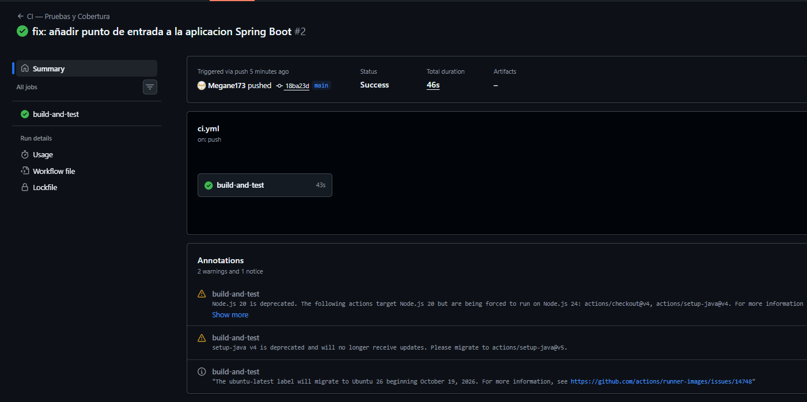
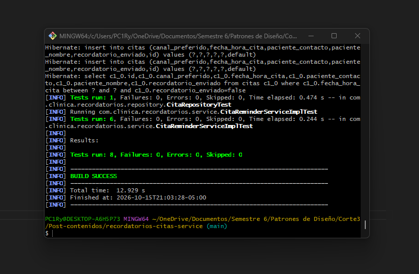

# Recordatorios Citas Service

## Documentación



## Descripción
Repositorio del post-contenido de la Unidad 9 de Patrones de Diseño
de Software — Sexto Semestre. Un único proyecto Spring Boot que
envía recordatorios de citas por el canal preferido del paciente,
construido desde el inicio con Strategy (ReminderChannel) y Factory
Method (ReminderChannelFactory) inyectados por constructor.

## Parte 1 — Pruebas Unitarias con JUnit 5 y Mockito
CitaReminderServiceImplTest aísla CitaReminderServiceImpl de sus
tres colaboradores. Ver "Decisiones de diseño" para la justificación
de por qué cada uno se mockeó, se stubeó o se resolvió con un fake.

## Parte 2 — Refactor DIP, Integración y CI/CD
enviarRecordatorioUrgente nació con un "new" hardcodeado que lo
hacía imposible de testear; el refactor lo movió a
config/CanalUrgenteConfig.java e inyectó la abstracción por
constructor. CitaRepositoryTest (@DataJpaTest) y
CitaReminderServiceIntegrationTest (@SpringBootTest) prueban la
persistencia y el flujo completo con H2 y un Clock fijo. El pipeline
.github/workflows/ci.yml ejecuta mvn verify en cada push.

## Decisiones de diseño

**Por qué Strategy facilitó las pruebas.** Sin ReminderChannel como
interfaz, la lógica de envío (SMTP o SMS) estaría escrita en línea
dentro del servicio, y probar la selección de canal exigiría mockear
librerías de bajo nivel (cliente SMTP, cliente HTTP) en vez de una
sola interfaz propia con un método enviar(). Con Strategy, un solo
@Mock ReminderChannel basta para verificar CUALQUIER canal.

**Por qué Factory facilitó las pruebas.** Sin
ReminderChannelFactory, el servicio tendría un if/else o un switch
embebido decidiendo el canal, y esa decisión solo sería observable
indirectamente (revisando qué se imprimió o qué se envió realmente).
Con la Factory inyectada, la selección de canal se verifica como una
interacción explícita: verify(reminderChannelFactory).obtenerCanal(EMAIL).

**Mock vs. Stub vs. Fake (Parte 1).** Para CitaRepository se utilizará un mock para evitar iniciar una base de datos, controlar el resultado de la consulta de citas pendientes y verificar que save() se invoque exactamente una vez por cada cita notificada. También se comprobará que la cita quede marcada como enviada. No se pretende validar la persistencia real, pues esta responsabilidad corresponde al repositorio y debe comprobarse mediante pruebas de integración. Aunque un stub permitiría simular el resultado de la consulta, no sería suficiente para verificar explícitamente las interacciones requeridas.

Para ReminderChannelFactory se utilizará un mock para controlar el canal devuelto y verificar que el servicio solicita el correspondiente a cita.getCanalPreferido(). El canal devuelto también se simulará para verificar que recibe la cita y el mensaje construido. El objetivo es evaluar las decisiones del servicio y sus interacciones con los colaboradores, no comprobar la lógica interna de selección de la fábrica ni el funcionamiento real del canal.

Para Clock se usará un fake apoyado en una implementación real del JDK, Clock.fixed(...). Se utilizará esta implementación de Java para fijar la fecha y la hora durante la prueba. Así se obtienen resultados deterministas de forma más simple y fiel que mockearla a mano.

## Ejecutar las pruebas
```bash
mvn test                  # Pruebas unitarias
mvn verify                # Unitarias + integración
```

## Herramientas utilizadas
- Java 21, Spring Boot 4.1, Spring Data JPA, H2, JUnit 5, Mockito
- Apache Maven, GitHub Actions, Git, GitHub

## Conclusiones
En este Postcontenido se aprendió a seleccionar test doubles adecuados según el tipo de prueba y comportamiento de los colaboradores de una clase y método a probar, se exploró la repercusión de no aplicar (DIP) en los test, se aprenden criterios para cuándo usar implementaciones reales y cuando mockear (pruebas de integración con H2 pero con mock de ApiGateway). Finalmente, se aplica workflow de integración continua con GitHub actions para automatizar la ejecución de las pruebas. Estos aprendizajes permiten pruebas más controlables y confiables, además de facilitar la detección temprana de errores durante el desarrollo. 
  